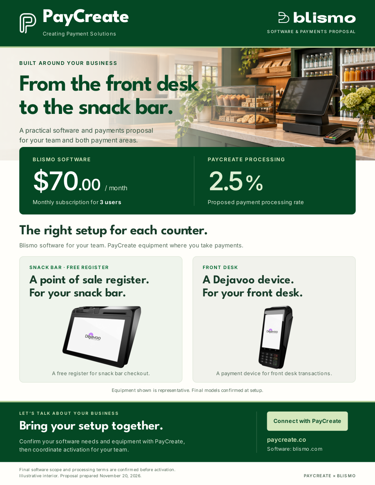

# PayCreate × Blismo

[Open the mobile proposal](https://cduque001.github.io/paycreate-preview/collateral/paycreate-blismo/?v=2) · [Download the PDF](https://cduque001.github.io/paycreate-preview/collateral/paycreate-blismo/PayCreate_Blismo_Proposal.pdf?v=2)

Software and payment processing proposal, November 20, 2026. Design revision 2 follows the established PayCreate proposal style.

- Blismo: **$70.00 per month for 3 users**.
- PayCreate: **2.5% payment processing**.
- Snack bar: **free point of sale register**.
- Front desk: **Dejavoo payment device**.

Equipment photography is representative. Final models, software scope, and processing terms are confirmed before activation. The reception/snack bar hero is an AI-generated illustrative interior, not a customer location.

Blismo logo: [blismo.com](https://blismo.com/). PayCreate branding: [paycreate.co](https://www.paycreate.co/). Representative equipment photography: Dejavoo [D1 register brochure](https://dejavoo.io/wp-content/uploads/2026/01/Dejavoo-D1-Android-Register_02_25.pdf) and [P1 terminal image](https://dejavoo.io/wp-content/uploads/2024/08/P1-2-scaled-1.webp). Font licenses are included in `assets/`.
